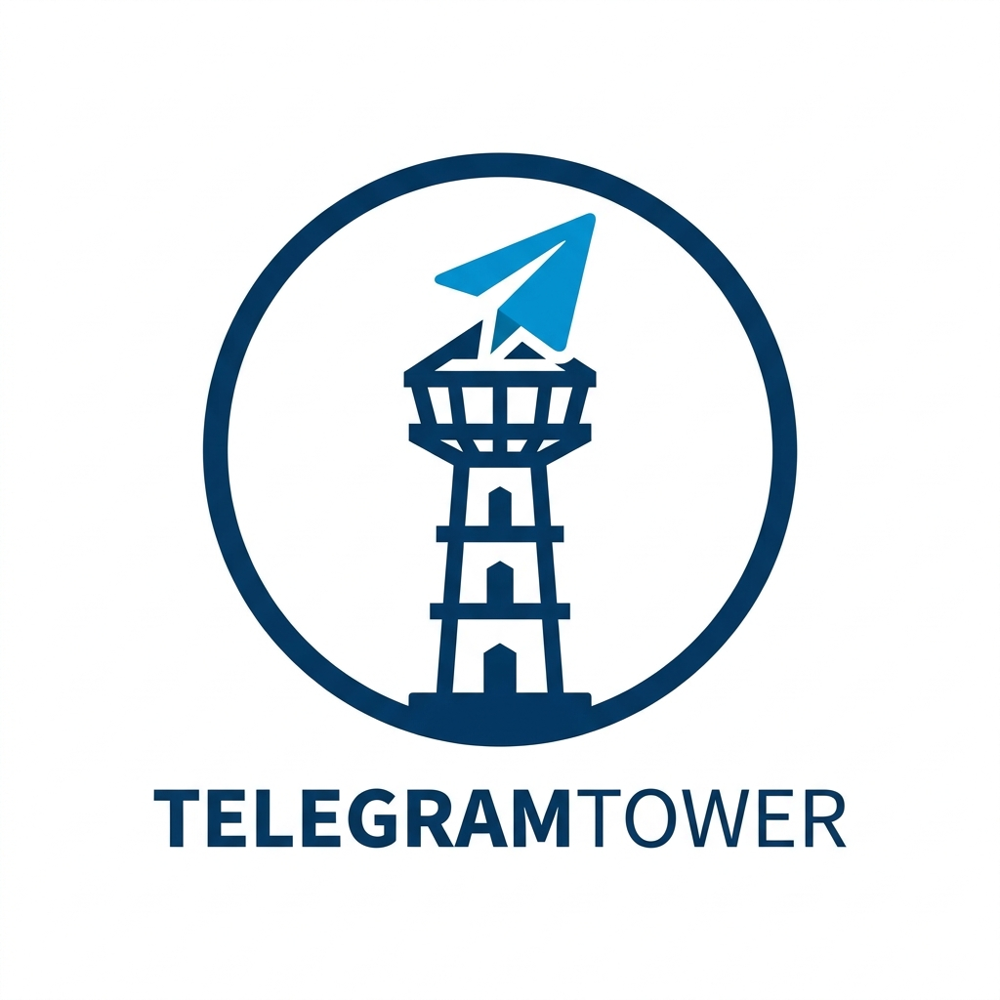

<div align="center">

</div>

# TelegramTower 🗼

TelegramTower is a lightweight, security-hardened Docker container update manager inspired by Watchtower. Instead of updating containers automatically and silently in the background, TelegramTower notifies you via Telegram and lets you approve updates with a single tap, with full auto-update and quarantine options.

---

## Security Architecture & Hardening 🛡️

Mounting `/var/run/docker.sock` gives a container root-equivalent control over the Docker host. TelegramTower incorporates enterprise-grade security hardening:

### 1. Docker Socket Proxy (Recommended)
Instead of mounting `/var/run/docker.sock` directly into TelegramTower, run TelegramTower alongside a **docker-socket-proxy** (e.g. `tecnativa/docker-socket-proxy`). This restricts API calls strictly to read/create/stop actions on containers and images, blocking dangerous endpoints such as `exec`, `volumes`, and `secrets`.
A ready-to-run template is provided in [`docker-compose.socket-proxy.yml`](docker-compose.socket-proxy.yml).

### 2. Web Dashboard Hardening
- **Fail-Closed Authentication:** Access to the dashboard requires `WEB_USER` and `WEB_PASSWORD`. Trivial passwords (`admin`, `password`, or <8 characters) are rejected at startup. To run without authentication, you must explicitly set `WEB_AUTH_DISABLED=true`.
- **Localhost by Default:** Bound to `127.0.0.1:8080:8080` to prevent unintended exposure to the local network or internet.
- **CSRF & Security Headers:** All state-changing requests require a signed CSRF token with `Origin`/`Referer` checks and `SameSite=Strict` session cookies. Hardened security headers include `Content-Security-Policy`, `X-Frame-Options: DENY`, `X-Content-Type-Options: nosniff`, and `Referrer-Policy: no-referrer`.
- **Secret Masking:** Telegram bot tokens are never rendered in plaintext in the HTML or transmitted in cleartext forms. Leaving the token field empty in settings preserves the existing token without overwriting or deleting it.
- **Brute-Force Rate Limiting:** Failed authentication attempts are automatically throttled (maximum 5 failed attempts per minute per IP before returning HTTP 429).
- **Production WSGI Server:** Powered by `waitress` in background threads rather than the Werkzeug development server.

### 3. Telegram Bot Authorization
- **Strict User & Chat Filtering:** Commands (`/start`, `/settings`, `/activehours`, `/language`) and callback buttons are strictly restricted to the authorized chat (`TELEGRAM_CHAT_ID`).
- **Group Chat Access Control:** When deploying in a group chat, configure `TELEGRAM_ALLOWED_USER_IDS` (comma-separated Telegram user IDs) to ensure only authorized administrators can trigger updates or change settings.
- **Audit Logging:** Unauthorized access attempts are answered with an alert and logged with masked identifiers.

### 4. Container Recreation Security
- **Full Security Options Preservation:** When recreating containers during updates, TelegramTower preserves all security-critical attributes from `HostConfig` and `Config`: `security_opt` (e.g. `no-new-privileges`), `cap_drop`, `cap_add`, `read_only`, `tmpfs`, `ulimits`, `sysctls`, `healthcheck`, `user`, `working_dir`, resource limits (`mem_limit`, `cpu_*`), and named volume mounts.
- **Automatic Health Check & Rollback:** The new container is inspected after starting. If it crashes or exits immediately, TelegramTower automatically restores and starts the backup container.
- **Self-Update & Infrastructure Protection:** TelegramTower detects its own container and docker-socket-proxy containers, blocking self-update attempts to prevent uncoordinated shutdowns.

### 5. Registry SSRF Defense
- When fetching token authentication challenges from image registries, `Www-Authenticate` realm URLs are strictly validated to ensure HTTPS and matched against trusted registry domains, blocking requests to private IPs or cloud metadata endpoints (`169.254.169.254`).
- All manifest digests are strictly validated against `^sha256:[a-f0-9]{64}$`.

---

## Features

* **Approval & Auto-Update:** Receive interactive Telegram messages when an update is available to manually approve them, or enable **Auto-Update** per-container to apply them automatically.
* **Compose & Network Aware:** Preserves Docker Compose labels and multiple network attachments when recreating containers. Automatically detects and recreates dependent network containers (e.g. `network_mode: service:vpn`) when their parent container is updated.
* **Dynamic Configuration:** Adjust settings like polling intervals and delays directly from an interactive Telegram menu without restarting the bot.
* **Quarantine Delay:** Delay update notifications for a specified number of days (1, 3, 5, 7 days) to ensure stability and protect against "day 0" bugs or compromised tags.
* **Active Hours (Horas Activas):** Set custom active hours (inspired by Windows Update) where automatic updates and restarts are paused (e.g. `08:00 - 02:00`) so services like Plex are never interrupted while in use. Pending updates are automatically deferred and applied during the maintenance window.
* **Release Version & Changelog Links:** Notifications parse release versions (OCI labels, version schemas, LinuxServer.io `build_version`) and display clickable links to release notes or source code when available.
* **Multi-Language Support (EN / ES):** Full internationalization in both Web Dashboard and Telegram. Switch dynamically between English and Spanish via `/language` / `/idioma` or dashboard toggle.
* **Event Notifications with Anti-Flood:** Real-time alerts when containers start (✅), stop/crash (🔴), or change health status (💚/🤒), with rate-limiting during crash loops to prevent spam.

---

## Environment Variables

| Variable | Description | Default |
| :--- | :--- | :--- |
| `TELEGRAM_BOT_TOKEN` | Bot token provided by [@BotFather](https://t.me/botfather). | *Required (or configure via Web)* |
| `TELEGRAM_CHAT_ID` | Telegram Chat ID authorized to operate the bot. | *Required (or configure via Web)* |
| `TELEGRAM_ALLOWED_USER_IDS` | Comma-separated list of Telegram User IDs allowed to execute actions (useful in group chats). | Authorized `TELEGRAM_CHAT_ID` |
| `WEB_USER` | Username for Web Dashboard Basic Auth. | `admin` |
| `WEB_PASSWORD` | Password for Web Dashboard (min 8 chars, non-trivial). | *Required unless auth disabled* |
| `WEB_AUTH_DISABLED` | Set to `true` to disable Web Dashboard authentication (use with caution). | `false` |
| `ALLOW_INSECURE_PASSWORD`| Set to `true` to allow passwords < 8 chars or trivial passwords. | `false` |
| `WEB_HOST` | Host address the Web Dashboard binds to. | `127.0.0.1` (or `0.0.0.0` in container) |
| `WEB_PORT` | Port for the Web Dashboard. | `8080` |
| `DOCKER_HOST` | Docker daemon URL (e.g. `tcp://socket-proxy:2375`). | Unix socket (`/var/run/docker.sock`) |
| `LOG_LEVEL` | Python logging level (`DEBUG`, `INFO`, `WARNING`, `ERROR`). | `INFO` |

---

## Quick Start

### Option A: Recommended Deployment with Docker Socket Proxy (Zero-Root)

```bash
docker compose -f docker-compose.socket-proxy.yml up -d
```

### Option B: Standard Deployment

Create `docker-compose.yml`:

```yaml
services:
  telegramtower:
    image: uniextra/telegramtower:latest
    container_name: telegramtower
    restart: unless-stopped
    security_opt:
      - no-new-privileges:true
    ports:
      - "127.0.0.1:8080:8080"
    volumes:
      - /var/run/docker.sock:/var/run/docker.sock
      - ./data:/app/data
    environment:
      - TELEGRAM_BOT_TOKEN=${TELEGRAM_BOT_TOKEN}
      - TELEGRAM_CHAT_ID=${TELEGRAM_CHAT_ID}
      - WEB_HOST=0.0.0.0
      - WEB_USER=admin
      - WEB_PASSWORD=${WEB_PASSWORD}
```

```bash
docker compose up -d
```

---

## Migration & Breaking Changes (v2.0.0)

1. **Authentication Fail-Closed:** The Web Dashboard now fails closed if `WEB_USER` or `WEB_PASSWORD` are not configured. The previous default password `admin/admin` is blocked. Set a strong password in your environment or set `WEB_AUTH_DISABLED=true` if behind an authenticated reverse proxy.
2. **Localhost Binding:** Compose port mapping defaults to `127.0.0.1:8080:8080`. To expose it to another interface, configure your reverse proxy or adjust your compose port mapping.
3. **Database Migration:** Legacy `config` table keys (`auto_*`, `last_updated_*`) are automatically migrated to the normalized `container_settings` table on first run without manual intervention.

---

## License

This project is open source and available under the [MIT License](LICENSE).
